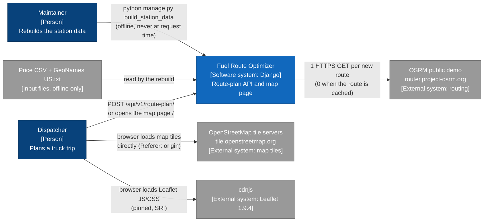
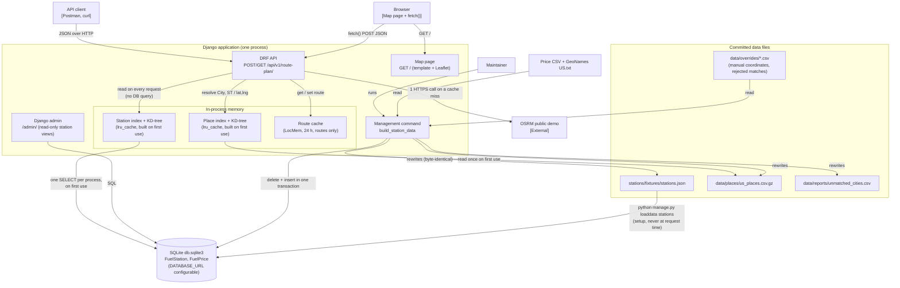
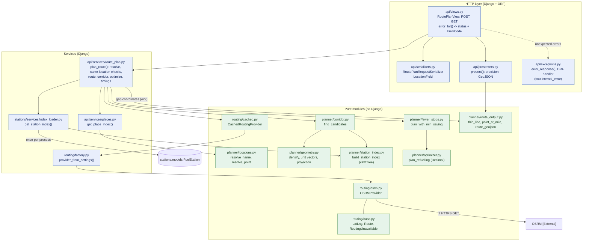
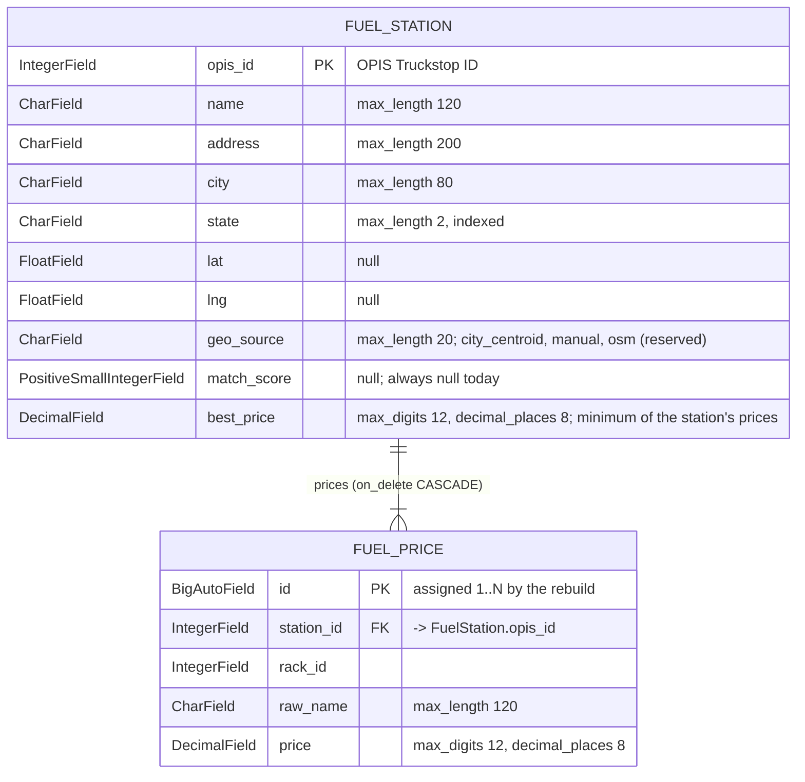

# Architecture

Four views of the system, each derived from the code: system context, containers, the components of
the request path, and the data model. The diagrams are Mermaid, so GitHub renders them in place.

## 1. System context (C4 level 1)

A dispatcher calls the API, or uses the map page in a browser. The only external call the system
itself makes is one OSRM routing request per new route; a repeated route makes none. Map tiles and
the Leaflet library are fetched by the browser, not by the server. Station coordinates are produced
offline by the maintainer from the price CSV and the GeoNames gazetteer.

## 2. Containers (C4 level 2)

Everything runs in one Django process. The request path reads only in-memory structures. The station
index is built from SQLite once per process on first use, and the place index once from the committed
gzip file. The only network call is OSRM on a route-cache miss. The rebuild command is offline. It
writes the database and the committed files in one go, and a fresh clone only needs `loaddata` to
fill SQLite from the committed fixture.

## 3. Components of the request path (C4 level 3)

**Legend:** green boxes are pure Python modules with no Django import (checked by AST tests), and
blue boxes use Django. The offline pipeline modules `stations/pipeline/*` are pure too, but they are
not on the request path.

The view parses the input and calls one service, `plan_route`. The service resolves both locations
against the in-memory place index, rejects identical points, and gets the route from the cache or
from one OSRM call. It then finds the stations in the corridor and runs the optimizer with the
minimum-saving rule. Everything that decides a result is in the green pure modules; the blue layer
only wires them to settings, the cache and the database.

## 4. Data model (ERD)

Two tables, from `stations/models/fuel_station.py` and `stations/models/fuel_price.py`. Each US
station appears once, keyed by its OPIS ID, with every raw price row kept in `FuelPrice`. The rebuild
only creates stations that have at least one price row, so the relation is one to one-or-more.

**Not tables:** the place lookup used for `"City, ST"` input is a committed gzip file
(`data/places/us_places.csv.gz`), loaded into memory once. The request path never queries the
database after the station index is built: one `SELECT` of `FuelStation` per process, on the first
request. `FuelPrice` is never read at request time; it is kept for traceability and the admin.
